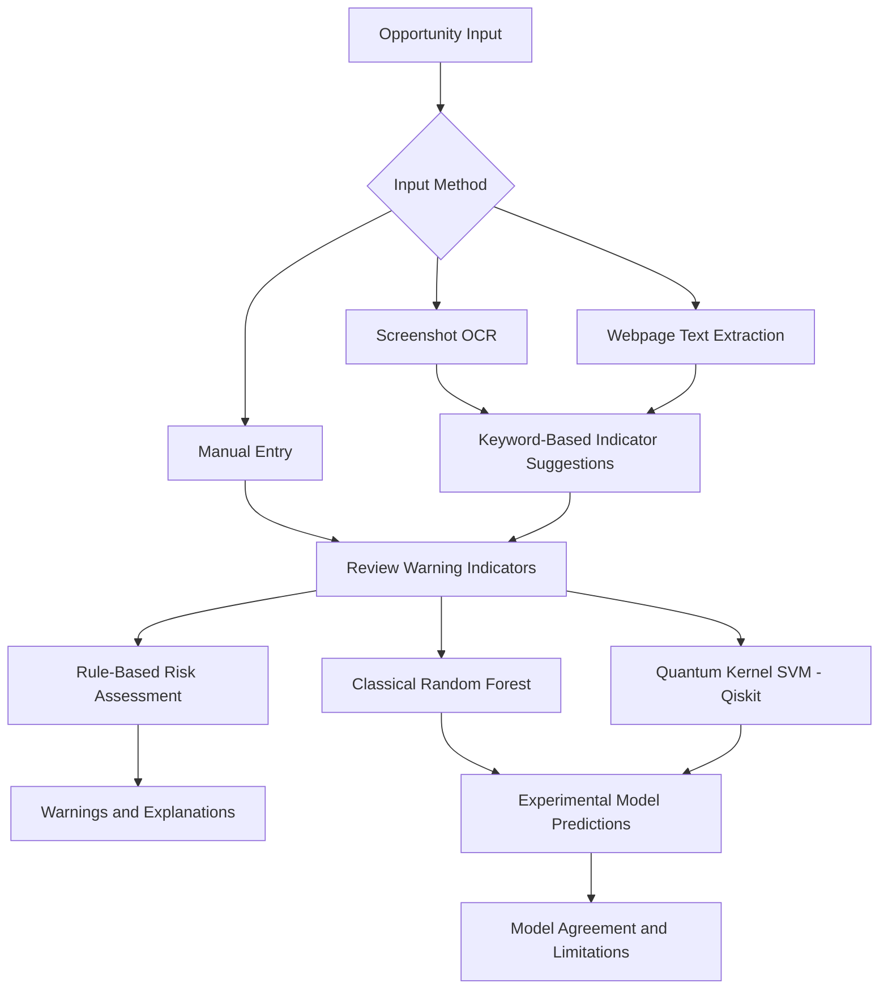

# 🛡️ QuantumShield

<div align="center">

**Qubit crew**  
**Team ID:** VTU-QFF-HC-0105 · **Tier:** Online

*Explainable Opportunity Risk Assessment using Classical and Quantum Machine Learning*

Built for **VTU-QFF Hackathon — VTU-Qiskit Fall Fest 2026**

</div>

---

## 📌 Table of Contents

- [Problem Statement](#-problem-statement)
- [Proposed Solution](#-proposed-solution)
- [Key Features](#-key-features)
- [Approach and Architecture](#-approach-and-architecture)
- [Technology Stack](#-technology-stack)
- [Project Structure](#-project-structure)
- [Getting Started](#-getting-started)
- [Running the Tests](#-running-the-tests)
- [Model Evaluation](#-model-evaluation)
- [Dataset and Limitations](#-dataset-and-limitations)
- [Team Members](#-team-members)
- [Git Collaboration Workflow](#-git-collaboration-workflow)
- [Submission Checklist](#-submission-checklist)
- [Resources](#-resources)
- [License](#-license)

---

## ❓ Problem Statement

Students regularly encounter job and internship offers, webinars, student competitions, and other opportunities online. Some may contain warning signs such as requests for upfront payments, unverified senders, unrealistic rewards, urgency tactics, or missing information.

It can be difficult for students to assess these warning signs quickly and understand why an opportunity may deserve closer inspection.

**Goal:** Build an explainable research prototype that helps students review potential warning signs and explore how classical and quantum machine-learning models behave on a small illustrative dataset.

## 💡 Proposed Solution

QuantumShield is a Streamlit web application that lets users enter opportunity details manually, upload a screenshot for text extraction, or provide a public webpage URL for text extraction.

The application suggests warning indicators using keyword-based rules, allows users to review those indicators, and produces an explainable warning-sign assessment. It also demonstrates predictions from a classical Random Forest model and an experimental Qiskit quantum-kernel support vector classifier.

**Key idea:** Combine understandable, rule-based warning indicators with an experimental comparison of classical and quantum machine learning.

> **Disclaimer:** QuantumShield is a research prototype. It does not establish whether an opportunity is genuinely safe or fraudulent. Its model outputs are experimental labels, not calibrated probabilities or verified fraud determinations.

## ✨ Key Features

- **Multiple input methods:** Enter warning indicators manually, upload a screenshot, or paste a webpage URL.
- **Screenshot text extraction:** Uses OCR to extract text from supported image formats.
- **Webpage text extraction:** Attempts to retrieve and extract text from a public webpage.
- **Suggested warning indicators:** Keyword-based rules suggest possible warning signs from extracted text.
- **Editable assessment:** Users can review and change the suggested indicators before assessing an opportunity.
- **Explainable assessment:** Shows which selected warning signs contributed to the rule-based assessment.
- **Classical machine learning:** Uses a Random Forest classifier.
- **Quantum machine learning:** Uses a Qiskit quantum-kernel SVM.
- **Model agreement view:** Shows whether the two experimental model predictions agree.
- **Evaluation dashboard:** Compares classical and quantum models using repeated stratified cross-validation and reports mean scores and standard deviations.

## 🧩 Approach and Architecture



### Processing steps

1. **Input:** The user enters details manually or supplies a screenshot or webpage URL.
2. **Text extraction:** OCR or webpage parsing extracts text when applicable.
3. **Indicator suggestions:** Keyword-based rules identify possible warning signs.
4. **User review:** The user reviews and edits the five binary indicators.
5. **Rule-based assessment:** The application counts selected warning signs and displays explanations.
6. **Model predictions:** The classical and quantum classifiers produce experimental labels.
7. **Evaluation:** A separate dashboard compares the models over repeated stratified cross-validation splits.

The keyword-based suggestions and the rule-based assessment are distinct from the machine-learning predictions.

## 🛠️ Technology Stack

| Component | Technology |
|---|---|
| Programming language | Python |
| User interface | Streamlit |
| Data handling | pandas, NumPy |
| Classical machine learning | scikit-learn, Random Forest |
| Quantum machine learning | Qiskit Machine Learning, QSVC |
| Quantum feature map | Qiskit ZZ feature map |
| Quantum kernel | FidelityQuantumKernel |
| Screenshot OCR | Pillow, pytesseract, Tesseract OCR |
| Webpage extraction | requests, Beautiful Soup |
| Testing | pytest |
| Development tools | VS Code, Git, GitHub |

## 📁 Project Structure

```text
vtu-hc-qubit-crew/
├── app/
│   └── streamlit_app.py       # Streamlit user interface
├── data/
│   └── sample.csv             # Small synthetic dataset
├── src/
│   ├── __init__.py
│   ├── input_processing.py    # Screenshot, webpage and text processing
│   ├── explanations.py        # Human-readable warning explanations
│   ├── risk_assessment.py    # Rule-based assessment
│   ├── model_service.py      # Model training and predictions
│   ├── compare_models.py     # Cross-validation comparison
│   ├── classical/
│   │   ├── __init__.py
│   │   └── baseline.py       # Classical baseline
│   └── quantum/
│       ├── __init__.py
│       └── kernel_model.py   # Quantum-kernel model experiment
├── tests/
│   ├── __init__.py
│   ├── test_baseline.py
│   ├── test_explanations.py
│   └── test_risk_assessment.py
├── requirements.txt
├── .gitignore
├── LICENSE
└── README.md
```

## 🚀 Getting Started

### Prerequisites

- Python 3.12 recommended for the environment used during development.
- Git installed on your computer.
- VS Code or another Python editor.
- Tesseract OCR installed and accessible through your system PATH for screenshot OCR.

### 1. Clone the repository

```bash
git clone https://github.com/vtu-qiskit-fall-fest-2026/vtu-hc-qubit-crew.git
cd vtu-hc-qubit-crew
```

### 2. Create and activate a virtual environment

**Windows PowerShell:**

```powershell
python -m venv .venv
.\.venv\Scripts\Activate.ps1
```

If PowerShell blocks activation, you can invoke the environment's Python directly using `.venv\Scripts\python.exe`.

**Linux or macOS:**

```bash
python3 -m venv .venv
source .venv/bin/activate
```

### 3. Install dependencies

```bash
python -m pip install --upgrade pip
python -m pip install -r requirements.txt
```

### 4. Launch QuantumShield

From the repository root, run:

```bash
python -m streamlit run app/streamlit_app.py
```

Open the local URL displayed in the terminal by Streamlit.

### 5. Try the application

1. Choose manual entry, screenshot upload, or webpage URL.
2. If using extracted text, review the text and request suggested indicators.
3. Review the suggested indicators and edit them as needed.
4. Submit the assessment to view the warning explanations and model outputs.
5. Open the model evaluation dashboard and run the comparison.

Only use webpage URLs you are authorized to access. Web extraction and keyword matching can fail, and users should independently verify important claims.

## 🧪 Running the Tests

From the repository root, with the project environment active:

```bash
python -m pytest tests -v
```

The existing tests cover the classical baseline and rule-based warning assessment. A passing test suite does not establish real-world fraud-detection performance or validate every input-processing and network-security scenario.

## 📊 Model Evaluation

QuantumShield compares two experimental approaches:

| Model | Approach |
|---|---|
| Classical baseline | Random Forest classifier |
| Quantum experiment | Qiskit quantum-kernel SVM using a ZZ feature map |

The evaluation script uses repeated stratified cross-validation with **3 folds and 3 repeats**, giving nine evaluation folds. It reports the mean and standard deviation of accuracy, precision, recall, and F1 score across those splits.

The current run on the synthetic dataset produced the following illustrative results:

| Metric | Classical Random Forest (mean) | Quantum Kernel SVM (mean) |
|---|---:|---:|
| Accuracy | 0.733 | 0.707 |
| Precision | 0.907 | 0.724 |
| Recall | 0.694 | 0.898 |
| F1 score | 0.742 | 0.790 |

These values are from the current experiment and may change if the dataset or evaluation procedure changes. Standard deviations are displayed in the application dashboard.

**Interpretation:** In this run, the classical model had higher mean accuracy and precision, while the quantum model had higher mean recall and F1 score. These results do **not** establish quantum advantage.

## ⚠️ Dataset and Limitations

The file `data/sample.csv` contains only **16 synthetic examples**. It is an illustrative dataset, not a collection of verified real-world job scams or legitimate opportunities.

The five binary input features are:

- `upfront_fee`: Whether an upfront payment is requested.
- `unverified_sender`: Whether the sender is unverified.
- `unrealistic_pay`: Whether the advertised pay or reward appears unrealistic.
- `pressure_tactics`: Whether urgency or pressure tactics are present.
- `missing_details`: Whether important opportunity details are missing.

The `label` column contains synthetic binary labels:

- `0`: Lower-risk example in the synthetic dataset.
- `1`: Higher-risk example in the synthetic dataset.

### Important limitations

- Sixteen examples are insufficient to establish reliable generalization to real-world opportunities.
- Cross-validation scores on this small synthetic dataset are highly uncertain.
- Keyword-based suggestions can miss warning signs or flag harmless language.
- Model agreement does not mean a prediction is correct.
- Model outputs are not calibrated probabilities.
- A low warning count does not guarantee that an opportunity is safe.
- Webpage extraction may fail on dynamic pages or pages that block automated requests.
- The current evaluation does not demonstrate a quantum speedup or quantum advantage.

### Future work

- Evaluate on a larger, responsibly collected and labeled dataset.
- Expand unit and security tests, particularly for URL fetching and screenshot processing.
- Improve the explainability of model predictions.
- Compare models with consistent evaluation protocols and uncertainty reporting.
- Explore quantum-kernel performance under controlled experiments before making claims about quantum advantage.

## 👥 Team Members

Team members should be listed with their actual names and GitHub usernames. Replace the placeholders below before submission.

| # | Name | GitHub Username | Role |
|---|---|---|---|
| 1 | *Teeratha P Sanmane* | *Add username* | Team Lead |
| 2 | *Samruddhi G Koparde* | *SamruddhiKoparde* | Developer |

**Team:** Qubit crew  
**Team ID:** VTU-QFF-HC-0105  
**Tier:** Online  
**Event:** VTU-QFF Hackathon — VTU-Qiskit Fall Fest 2026

### Commit message conventions

| Prefix | Meaning |
|---|---|
| `feat:` | New feature |
| `fix:` | Bug fix |
| `docs:` | Documentation |
| `test:` | Test changes |
| `refactor:` | Code restructuring |
| `chore:` | Build, dependency, or configuration changes |

## ✅ Submission Checklist

- [ ] Repository visibility and submission requirements verified.
- [ ] Team members and GitHub usernames added.
- [ ] README project description and limitations reviewed.
- [ ] Dependencies listed in `requirements.txt`.
- [ ] Application launches from a clean environment.
- [ ] Tests pass.
- [ ] Demo screenshot or video link added, if required.
- [ ] Project summary submitted through the hackathon portal.
- [ ] Latest code pushed to the required branch.

## 📚 Resources

| Resource | Link |
|---|---|
| Project repository | [vtu-hc-qubit-crew](https://github.com/vtu-qiskit-fall-fest-2026/vtu-hc-qubit-crew) |
| Qiskit documentation | [IBM Quantum documentation](https://docs.quantum.ibm.com/) |
| Qiskit Runtime | [IBM Quantum Platform documentation](https://quantum.cloud.ibm.com/docs/) |
| Qiskit Aer | [Qiskit Aer guide](https://docs.quantum.ibm.com/guides/simulators) |
| Qiskit learning resources | [Qiskit learning](https://qiskit.qotlabs.org/learning/) |
| GitHub documentation | [GitHub Docs](https://docs.github.com/) |

## 📄 License

This project is released under the MIT License. See [LICENSE](LICENSE) for details.

---

<div align="center">

**Qubit crew** · `VTU-QFF-HC-0105` · Online

*Built with Python, Streamlit and Qiskit for VTU-Qiskit Fall Fest 2026.*

[Back to top](#-quantumshield)

</div>
